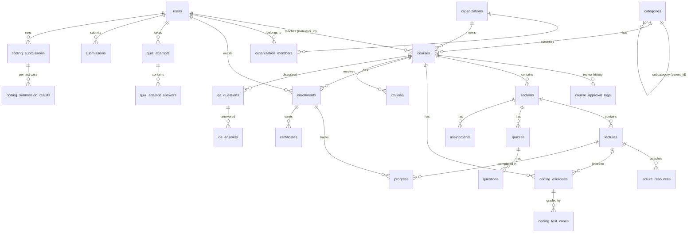

# Database Design

PostgreSQL (Supabase). **58 tables** in 11 areas, covering everything in `PROJECT.md`
except payments, live classes and study groups (explicitly future, not MVP).

How to set up and change the database: `database/README.md`.
Exact column definitions: `backend/app/models/` or `database/schema/database-schema.sql`.

## Conventions
- **IDs**: `VARCHAR(64)` UUID strings generated by the backend (`platform_settings` uses its `key`;
  the three `*_topics` link tables use composite keys).
- **Timestamps**: `TIMESTAMP WITH TIME ZONE`, stored in UTC.
- **Allowed values** (status, type, role...) are `VARCHAR` + `CHECK` constraints rather than Postgres
  ENUM types, because adding a value then needs only a small migration.
- **"One per user"** rules are enforced by the database with `UNIQUE` constraints, not just by API code.
  This is what stops race-condition duplicates.
- **Deleting a user**: their personal data (enrollments, notes, drafts...) is deleted (`ON DELETE CASCADE`);
  content other people rely on (Q&A posts, reviews they moderated, audit logs) keeps the row and sets
  the user to `NULL`.
- **Security**: Row Level Security is enabled on every table, and only the FastAPI backend reads or writes data.

## Core relationships

## Tables by area

### 1. Users and organizations
| Table | Purpose | Key rules |
|---|---|---|
| `users` | Accounts for all roles: `learner`, `instructor`, `super_admin` | email unique; `status` ∈ active / inactive / suspended (non-active users can't log in or use tokens) |
| `organizations` | Universities, colleges, schools, institutes, companies | `org_type` checked; `slug` unique |
| `organization_members` | Who belongs to which organization, and their role in it | one membership per user per org |

### 2. Catalog and course content
| Table | Purpose | Key rules |
|---|---|---|
| `categories` | Categories and subcategories (`parent_id`) | `slug` unique |
| `courses` | Course details, objectives, prerequisites, level, language, approval status | optional `organization_id` |
| `course_approval_logs` | Every submit / approve / reject / request-changes decision with comments ("approval history") | append-only |
| `sections` | Curriculum sections | ordered by `order_index` |
| `lectures` | `video`, `article`, `pdf`, `document` or `link` lectures; `is_preview` for free previews | type checked |
| `lecture_resources` | Downloadable files and external links per lecture | |
| `lecture_subtitles` | Caption tracks per language | one per lecture per language |

### 3. Learning
| Table | Purpose | Key rules |
|---|---|---|
| `enrollments` | Learner ↔ course; `last_lecture_id` / `last_accessed_at` for "continue learning" | one per learner per course |
| `progress` | Lecture completion and `last_position_seconds` (resume video) | **one per enrollment per lecture** |
| `lecture_notes` | Private notes, optionally at a video timestamp | |
| `lecture_bookmarks` | Saved moments in a lecture | |
| `wishlist_items` | Saved courses | one per learner per course |

### 4. Assessments
| Table | Purpose | Key rules |
|---|---|---|
| `quizzes` | Quizzes **and practice tests** (`quiz_type`); time limit, attempt limit, shuffle | passing score 0–100 |
| `questions` | `single_choice`, `multiple_select`, `true_false`; explanation, points | |
| `quiz_attempts` | One attempt: score, pass/fail, timing, attempt number | |
| `quiz_attempt_answers` | What was answered per question: quiz review, per-question stats, weak topics | one per attempt per question |
| `assignments` | Instructions, deadline, max score, resubmission allowed | |
| `submissions` | Learner's submission, grade, **feedback**, grader, status | one per learner per assignment (resubmitting updates it) |
| `submission_files` | Uploaded files for a submission | |

### 5. Coding workspace (PROJECT.md §11–13)
| Table | Purpose | Key rules |
|---|---|---|
| `coding_exercises` | Problem, starter / solution code, samples, hints, limits, difficulty; optionally linked to a lecture | language ∈ python, c, cpp, javascript, java, sql |
| `coding_test_cases` | Input / expected output; `is_hidden` cases are never shown to learners | |
| `coding_submissions` | Every Run (`kind='run'`) and Submit (`kind='submit'`): code, status, score, passed/failed counts, time, memory | status ∈ queued, running, accepted, wrong_answer, runtime_error, compile_error, time/memory limit, internal_error |
| `coding_submission_results` | Per-test-case result ("Test Case 3 → Failed") | |
| `coding_drafts` | Autosaved editor contents | one per learner per exercise |

> Student code must run in an **isolated sandbox** (e.g. Judge0 or locked-down containers), never inside
> FastAPI. The sandbox picks up `queued` submissions and writes results back to these tables.

### 6. Completion and feedback
| Table | Purpose | Key rules |
|---|---|---|
| `certificates` | Issued certificates with a public `verification_code`, name/title snapshots, revoke support | one per learner per course |
| `reviews` | 1–5 star ratings and text; moderation `status` | one per learner per course |

### 7. Community and moderation
| Table | Purpose | Key rules |
|---|---|---|
| `qa_questions` | Course / lecture discussion questions | moderation `status` |
| `qa_answers` | Answers and threaded replies (`parent_answer_id`); `is_highlighted` by instructor | |
| `qa_answer_votes` | Upvotes | one per user per answer |
| `qa_question_follows` | Follow a question for reply notifications | one per user per question |
| `content_reports` | Reports on courses, reviews, Q&A posts or users; admin resolves them | status ∈ open, reviewing, resolved, dismissed |

### 8. Notifications
| Table | Purpose |
|---|---|
| `notifications` | In-app notifications (+ `email_sent_at` when also emailed) |
| `notification_preferences` | Per-user on/off per notification type and channel |
| `announcements` | Instructor → course, or Super Admin → platform-wide |

### 9. Security and platform
| Table | Purpose |
|---|---|
| `auth_tokens` | Hashed one-time tokens: email verification, password reset, refresh tokens |
| `login_history` | Every login attempt (success / failure, IP, device) |
| `audit_logs` | Who changed what (`user.suspended`, `course.approved`, ...) with before/after values |
| `platform_settings` | Key/value settings (platform name, approval rules, certificate rules...). 22 defaults inserted by migration `0004` |

### 10. Personalized learning (PROJECT.md §24)
| Table | Purpose |
|---|---|
| `topics` | Skills / concepts, nestable |
| `course_topics`, `question_topics`, `coding_exercise_topics` | Tag content with topics: this is what makes weak-topic detection possible |
| `user_topic_mastery` | Per-learner score per topic (low = weak topic) |
| `learning_goals` | Weekly-minutes, finish-course and master-topic goals |
| `learning_paths`, `learning_path_courses`, `learning_path_enrollments` | Ordered course sequences |
| `recommendations` | Suggested course / lecture / exercise with reason, plus click and dismiss tracking |
| `learning_activity_daily` | One row per learner per day: minutes, lectures, quizzes, coding. Drives charts, learning time and streaks |

### 11. Gamification and AI
| Table | Purpose |
|---|---|
| `badges`, `user_badges` | Badge catalog (11 starter badges seeded) and awards, one per user per badge |
| `point_transactions` | Points ledger; leaderboards = `SUM(points)` |
| `user_streaks` | Current / longest learning and coding streaks |
| `ai_conversations`, `ai_messages` | AI learning / coding / instructor assistant chats with context (lecture, exercise...) and token usage |

## Not in the schema (by design)
Payments, pricing, coupons, subscriptions, live classes, study groups and contests are listed as
**future** in PROJECT.md §29. Add them with new migrations when they're scheduled.
